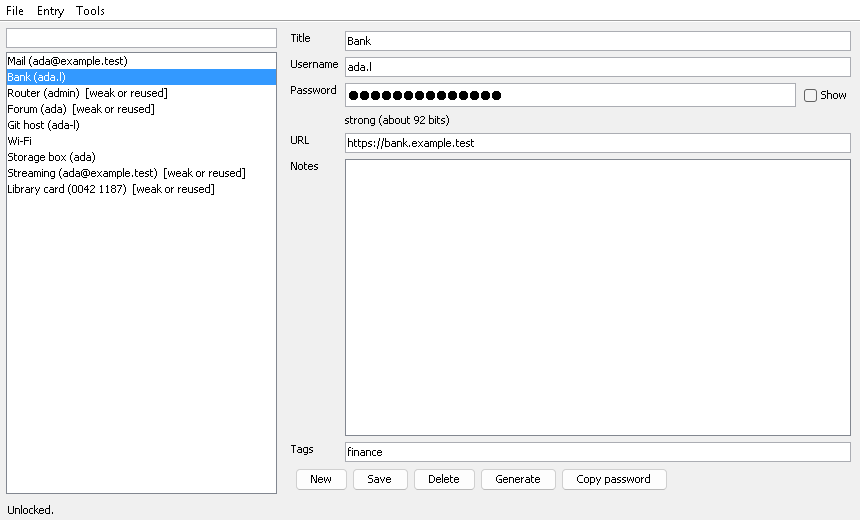
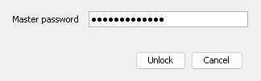

# vaultlite

A local, encrypted password and notes vault in plain Java 21 with no dependencies. It has a command line and a small Swing GUI that uses the system look and feel.

**This is an unaudited hobby project.** I wrote it to see how far the JDK's own crypto goes. Nobody has reviewed it, it has had no side-channel or memory-forensics work, and it is not a replacement for a vetted manager such as KeePassXC or Bitwarden. Do not keep the only copy of anything important in it.

The screenshots are rendered headless from a synthetic demo vault (`gui --snapshot`).

## Build

    build.cmd          (or: sh build.sh)   -> out/vaultlite.jar
    test.cmd           (or: sh test.sh)    builds and runs the tests

Only `javac` and `jar` from a JDK 21 are needed.

## Use

    java -jar out/vaultlite.jar init
    java -jar out/vaultlite.jar add Mail --user ada --url https://mail.example --tag personal
    java -jar out/vaultlite.jar add Wifi --gen
    java -jar out/vaultlite.jar list
    java -jar out/vaultlite.jar show Mail --reveal
    java -jar out/vaultlite.jar copy Mail --clear 20
    java -jar out/vaultlite.jar audit
    java -jar out/vaultlite.jar gen --passphrase --words 5 --capitalise --digit
    java -jar out/vaultlite.jar breach Mail --online
    java -jar out/vaultlite.jar export backup.vlt
    java -jar out/vaultlite.jar import backup.vlt
    java -jar out/vaultlite.jar rekey
    java -jar out/vaultlite.jar gui

`vaultlite help` lists every option. The vault file is `~/.vaultlite/vault.vlt`, or `--vault FILE` / `VAULTLITE_FILE`. The master password is read without echo from the console; when stdin is piped it is read as a line, which is what the tests use.

The GUI asks for the master password in a dialog (it also creates the vault if the file does not exist yet). The main window has a search box and entry list on the left and a form on the right; New, Save, Delete, Generate and Copy password are buttons under the form, and the menus have lock, audit, breach check, export and import. Ctrl+N new, Ctrl+S save, Ctrl+F search, Ctrl+L lock. It locks itself after 120 idle seconds (`gui --autolock N`, 0 disables). Copies clear the clipboard after 20 seconds, and only if it still holds what was copied.

`gui --snapshot out.png [--locked]` renders a demo vault without opening a window; CI uses it as a smoke test.

## How it stores things

File layout: `VLT1`, version, KDF id, iteration count, salt length, 16 byte random salt, 12 byte random nonce, then AES-256-GCM ciphertext and tag. The whole header is passed to GCM as associated data, so changing any header byte, including the iteration count, makes decryption fail. The key is PBKDF2-HMAC-SHA256 from the JDK, at least 600,000 iterations (the count is stored in the file; `rekey` raises it and rotates the salt). Every save uses a fresh nonce. Saves write a temp file, fsync it, copy the old file to `.bak`, then atomically move the temp over the vault.

Plaintext is JSON that only exists in memory. Nothing is logged. Key and password arrays are zeroed when the vault closes, but Java strings (entry fields, anything typed into a Swing text field) cannot be wiped and may linger in the heap or swap.

The breach check sends the first 5 hex characters of the SHA-1 to `api.pwnedpasswords.com` and compares the rest locally. It only runs when you pass `--online` or confirm the GUI dialog, per use. Export files use the same container with their own password; import merges and skips entries that already match.

## What it does not do

- Strength estimate is a character-pool heuristic with a few penalties, not a real guessing model.
- No clipboard-history protection: Windows clipboard history or a clipboard manager may keep a copy.
- No file locking; two instances writing the same vault will last-writer-win.
- Unsaved edits are only guarded when you switch entries or press New; closing the window drops them.
- The passphrase list is a 256 word list I wrote, 8 bits per word.
- Not tested on macOS; the GUI was only looked at on Windows.
